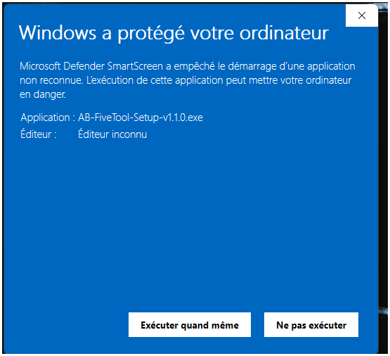

# AB FiveTool

Outil Windows pour **GTA V / FiveM** : nettoyer, ranger et accéder rapidement à ses dossiers de jeu.

## Fonctionnalités

- **Vider le cache FiveM** (logs, crashes, data)
- **Nettoyer GTA V** (retour au vanilla) : la liste des fichiers détectés est affichée et une confirmation est demandée avant toute suppression
- **« Aller au dossier »** en un clic pour FiveM, GTA V et les mods FiveM
- **Détection automatique** des dossiers FiveM et GTA V, modifiables dans les Paramètres
- Interface en **français et anglais**, selon la langue de l'utilisateur
- **Mises à jour automatiques** via GitHub : un message affiche les nouveautés au lancement, et l'intégrité du téléchargement est vérifiée (SHA256)

## Téléchargement

Rendez-vous dans **[Releases](../../releases/latest)** et choisissez :

| Fichier | Usage |
|---|---|
| `AB-FiveTool-Setup-<version>.exe` | **Installateur** (recommandé), sans droits administrateur |
| `AB-FiveTool-Portable-<version>-win-x64.zip` | Version portable, sans installation |
| `SHA256SUMS.txt` | Sommes de contrôle pour vérifier les fichiers |

Windows 64 bits requis (comme GTA V et FiveM).

## Installation

**Avec l'installateur** : lancez `AB-FiveTool-Setup-<version>.exe` et suivez l'assistant.

**Version portable** :

1. Décompressez l'archive dans un dossier (ex. `C:\Program Files\AB FiveTool`).
2. Lancez `AB FiveTool.exe`.

Au premier lancement, vérifiez dans l'onglet **Paramètres** les chemins de **FiveM.app** et de **GTA V**.

## Windows affiche « Windows a protégé votre ordinateur » ?

Au **premier téléchargement**, Windows SmartScreen peut bloquer le lancement et afficher « Éditeur inconnu ». AB FiveTool est un petit logiciel gratuit qui n'est pas signé par un certificat de signature de code payant : Windows se méfie donc de tout fichier qu'il ne connaît pas encore.

1. Cliquez sur **Informations complémentaires**.
2. Cliquez sur **Exécuter quand même**.



Pour vérifier que votre fichier n'a pas été altéré, comparez sa somme SHA256 avec `SHA256SUMS.txt` (dans la release) :

```powershell
Get-FileHash .\AB-FiveTool-Setup-<version>.exe -Algorithm SHA256
```

Les mises à jour faites depuis l'application ne devraient pas afficher cet avertissement.

## Mises à jour

L'application vérifie GitHub au lancement. Si une nouvelle version existe, une fenêtre présente les nouveautés et propose de **mettre à jour maintenant** ou **plus tard**. Vous pouvez aussi remplacer les fichiers à la main par ceux de la dernière release.

## Prérequis

Aucun : l'application est **autonome** (.NET inclus).

## Notes

- Les journaux sont dans `C:\ProgramData\AB-FiveTool\logs`.
- La configuration est dans `C:\ProgramData\AB-FiveTool\config.json`.

## Confidentialité

AB FiveTool ne collecte aucune donnée personnelle. Les opérations se font localement ; seul le contrôle des mises à jour contacte GitHub.

## Licence

Logiciel propriétaire : utilisation libre, mais redistribution, revente et modification interdites. Voir [LICENSE](LICENSE.txt).

---

© 2024-2026 AlexBZicker — Tous droits réservés. — [alexbzicker.fr](https://alexbzicker.fr/)
